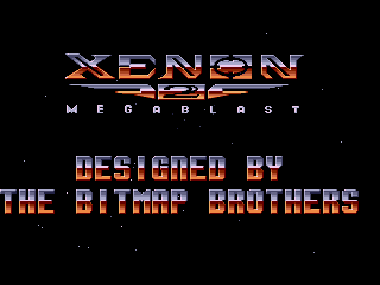

# RXDK-Xenon2

<p align="center"><b>Xenon 2 Megablast (the 1991 CDTV release) on the original Xbox — the Bitmap Brothers' own 68000 code recompiled to C++, with native sound and the Bomb the Bass CD soundtrack, built with RXDK</b></p>

<p align="center">
  <a href="https://github.com/Team-Resurgent/RXDK-Xenon2/blob/main/LICENSE.md"></a>
  <a href="https://discord.gg/VcdSfajQGK"></a>
</p>

<p align="center">
  <a href="https://ko-fi.com/J3J7L5UMN"></a>
  <a href="https://www.patreon.com/teamresurgent"></a>
</p>

<p align="center">
  
</p>

The Bitmap Brothers' own 68000 code is statically recompiled to C++: the
game logic is the original. The Amiga hardware it talks to is replaced by
native code. File and CD access are hooked at the routines the WHDLoad
install patches, and the display, sound and music move to native D3D8 and
DirectSound code.

You need your own copy of the game: the WHDLoad CDTV install
(`Xenon2_v1.7_CDTV.lha`, or its unpacked folder). For music, the CDTV
version plays CD audio tracks, which the install doesn't include: a BIN/CUE
rip of the CDTV disc gives them all. Without one, the Xenon2Audio add-on
(`Xenon2Audio_v0.2b_BETA.lha`) has Bomb the Bass's music as one piece,
which plays for every track, carrying on across scenes rather than starting
again. No game data or generated code is in this repository.

## Build

```
python tools/build.py --install <Xenon2_v1.7_CDTV.lha>
```

For music, add `--music <the disc's .cue, or its folder>` (or
`--music <Xenon2Audio_v0.2b_BETA.lha>`), once. Later builds need neither.
You need RXDK (`C:\ProgramData\RXDK`, or set `RXDK` / `RXDK_CLI`), Python 3,
7-Zip (for `.lha` archives) and, for music, ffmpeg with libvorbis. The
output is `out/xenon2.xbe` and `out/XISO/xenon2.iso`.

## How it works

| Step | Tool | What it does |
|---|---|---|
| extract | `tools/extract.py` | copies the CDTV files into `game/data`; relocates the `X2` hunks at `$400` into `build/image.bin`, as WHDLoad's `resload_Relocate` does |
| analyse | `tools/m68k/analyze.py` | finds the functions of the main program and of the seven code overlays (Intro, Piccode, Level1-5: GEMDOS-format files loaded at `$4E26` and relocated by `$406`), from call targets, relocated pointers, jump tables and the `jmp` service table at `$E12` |
| recompile | `tools/recompile.py`, `tools/m68k/codegen.py` | writes one C++ function per 68000 function into `build/m68k`, with dispatch tables by address |
| runtime | `src/runtime` | the CPU state and helpers (`m68k.h`), dispatch, interrupts and exceptions (`cpu.cpp`), the chipset at line granularity (`chipset.cpp`), and native hooks (`hooks.cpp`) |
| sound | `src/runtime/sound.cpp` | the game's two sound voices (started by a hook at its voice routine, `$3351E`) and the CD music, mixed natively at 48 kHz |
| music | `tools/music.py` | the music as Ogg Vorbis in `game/music`: the disc's tracks as `trackNN.ogg` (from INDEX 01, past the pregap), or the add-on's piece as `btb.ogg`; decoded on the Xbox by [stb_vorbis](third_party/stb_vorbis) (public domain) |
| Xbox | `src/platform/xbox/main.cpp`, `audio.cpp` | D3D8 display, controller, pacing at 50 Hz; DirectSound output and music streaming |

`config/xenon2.json` lists the patched routines: the WHDLoad slave's OS
skips, the file loads, and the CDTV CD-audio calls (`cd_play` is track
`d0`).

## Status

The game runs in xemu: the joypad and language screens, the intro with
speech, high scores and Level 1 gameplay, with sound effects, speech and
music. It draws through the reference renderer, which builds the frame from
the bitplanes, sprites and copper as the Amiga would, centred on the screen.

Still to do:

- **HD renderer:** native rendering at 480p/720p from the game's own draw
  calls, with HD textures (the Xenon 2000 art where it fits, upscaled
  originals elsewhere) and 60 Hz interpolation (the game updates every third
  PAL frame).
- **High scores:** saving them.

## Controller

D-pad or left stick to move. A or right trigger is button A (fire); B or X
is the second button.

## Licence

The code in this repository is GPLv3 ([LICENSE.md](LICENSE.md)).
[stb_vorbis](third_party/stb_vorbis) keeps its own licence (public domain,
or MIT). Xenon 2 Megablast itself, its data and its music belong to their
owners and are not covered: you supply your own copy.
